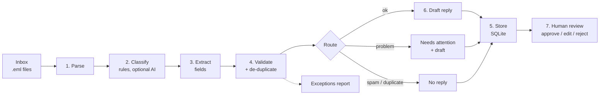

# Inbox Triage Workflow

A small, end-to-end workflow automation that turns a messy shared inbox into **clean, validated records** and **ready-to-approve draft replies**.

It reads incoming emails, works out what each one is (internship enquiry, sales lead, support request, vendor pitch or spam), pulls out the useful details, checks them for problems, saves everything to a SQL database and drafts a reply. A person approves every reply. Nothing is sent automatically.

**▶ Live demo: <https://mrunalkulkarni082.github.io/inbox-triage/>**: runs entirely in your browser, with no sign-up. The first load takes about 20–40 seconds while Python starts up.

The demo has two modes:

- **✍️ Check one email live.** Type or paste any email and see every stage: classification with its reasons, extracted fields, validation issues, the outcome and the draft reply. Eight ready-made examples (`data/live_examples.json`) can be loaded with one click or copied. They are **new** emails, not the 30 the rules were tuned on. Checking the same email twice shows duplicate detection.
- **📥 Process a whole inbox.** Run the 30-email sample inbox, or upload your own `.eml` files, and use the review queue, exceptions report, accuracy check, SQL tab and run log.

| | |
|---|---|
| **Language** | Python 3.12 |
| **Stack** | Pydantic · SQLite (SQL) · pandas · Jinja2 · Streamlit · pytest · optional Claude API |
| **Sample data** | 30 fictional emails, deliberately messy |
| **Tests** | 63 automated tests (unit + end-to-end) |
| **Run time** | ~0.1 s for 30 emails on a laptop |

---

## Contents

1. [The problem](#1-the-problem)
2. [What the workflow does](#2-what-the-workflow-does)
3. [Quick start](#3-quick-start)
4. [Architecture](#4-architecture)
5. [Stage-by-stage walkthrough](#5-stage-by-stage-walkthrough)
6. [The data model and database](#6-the-data-model-and-database)
7. [Results on the sample inbox](#7-results-on-the-sample-inbox)
8. [How it is tested](#8-how-it-is-tested)
9. [The optional AI step](#9-the-optional-ai-step)
10. [Design decisions and trade-offs](#10-design-decisions-and-trade-offs)
11. [Limitations](#11-limitations)
12. [What I would build next](#12-what-i-would-build-next)
13. [Project structure](#13-project-structure)
14. [Deploying the demo](#14-deploying-the-demo)
15. [Walkthrough script for a demo call](#15-walkthrough-script-for-a-demo-call)

---

## 1. The problem

Most small businesses have one shared inbox (`hello@`, `info@`, `admin@`) that receives everything: job and internship enquiries, potential clients, existing clients reporting problems, vendors selling services, and spam.

Someone has to read each email, decide what it is, copy the important details somewhere (a spreadsheet, a CRM), notice what is missing, and write a reply. That work is:

- **Repetitive.** The same five or six kinds of email arrive every week.
- **Error-prone.** Details get mistyped, duplicates are entered twice, follow-ups are not linked to the first email.
- **Invisible.** There is no record of how many enquiries of each kind arrived, or how long they waited.

This project automates the repetitive part and leaves the judgement to a person.

## 2. What the workflow does

For every email in the inbox:

1. **Parse** the raw email file into clean fields (sender, subject, date, body, attachments).
2. **Classify** it into a category, with a **confidence score** and the **reasons** for the decision.
3. **Extract** structured details: name, organisation, phone, skills, graduation year, weekly hours, order ID, budget, and a one-line summary of the request.
4. **Validate** those details: missing required fields, malformed phone numbers, graduation years in the past, duplicates, follow-ups, mismatched reply addresses.
5. **Store** the record, its issues and the run log in a SQLite database.
6. **Draft** a reply from a template for that category. The reply asks for whatever is missing.
7. **Human review.** Each draft waits in a queue where a person approves, edits or rejects it.

Every email ends up with exactly one outcome:

| Outcome | Meaning |
|---|---|
| ✅ `ready_for_review` | Classified confidently, no blocking problems; draft ready for approval |
| ⚠️ `needs_attention` | Low confidence or a blocking problem (for example, a support email with no order number); a person should look first |
| 🔁 `duplicate` | Already processed (same content seen before); no new record, no reply |
| 🗑️ `discarded` | Spam; stored for the record but never replied to |

## 3. Quick start

```bash
# 1. Create an environment and install dependencies
python -m venv .venv
.venv\Scripts\activate          # Windows
# source .venv/bin/activate     # macOS / Linux
pip install -r requirements.txt

# 2. Run the workflow on the sample inbox (command line)
python run_pipeline.py --reset

# 3. Or open the interactive demo in a browser
streamlit run app.py

# 4. Run the tests
pytest -q
```

The command-line run writes four files to `output/`:

| File | What it is for |
|---|---|
| `triage.db` | SQLite database with every record, issue, review and run |
| `exceptions.csv` | Every validation issue: a to-do list for a person |
| `review_queue.csv` | Every draft reply waiting for approval |
| `run_report.json` | Counts, timings and failures for the run (the audit log) |

Other options:

```bash
python run_pipeline.py --inbox path/to/folder_of_eml_files   # your own emails
python run_pipeline.py --ai                                  # use Claude (needs ANTHROPIC_API_KEY)
python scripts/generate_sample_inbox.py                      # rebuild the sample emails
```

Any mail client can export emails as `.eml` files. In Gmail, open a message, then use **⋮ → Download message**.

## 4. Architecture



Each stage is a separate Python module with one job. Stages pass **typed objects** to each other (defined in `triage/models.py`), not loose dictionaries:

```
RawEmail ──► Classification ──► ExtractedFields ──► [ValidationIssue] ──► ProcessedEmail ──► RunReport
```

This gives three benefits:

- **Each stage can be tested on its own.** A test can hand the validator a hand-made record without parsing any email.
- **Bad data fails loudly.** Pydantic checks every field type; a confidence of 1.7 or a missing category raises an error instead of reaching the database.
- **Stages can be swapped.** The rule-based classifier and the AI classifier return the same `Classification` object, so the rest of the pipeline does not care which one ran.

The orchestrator, `triage/pipeline.py`, runs the stages in order, times each one, and catches errors per email so that **one broken file never stops the run**.

## 5. Stage-by-stage walkthrough

### Stage 1: Parse (`triage/parser.py`)

**Input:** a `.eml` file, the standard email format every mail system can export.
**Output:** a `RawEmail`.

What it does:

- Uses Python's built-in `email` library to read headers, body and attachments.
- Prefers the plain-text part of the email. If there is none (HTML-only email), it converts the HTML to text: line breaks are kept, tags removed, and entities like `&amp;` decoded.
- Handles a missing subject (`"(no subject)"`), a missing or invalid date, and a missing Message-ID.
- Normalises the sender address to lower case.
- Computes a **fingerprint**: a SHA-256 hash of the sender, subject and body after collapsing whitespace and lower-casing.

**Why the fingerprint matters.** It identifies an email by its *content*, so the same email re-sent, or exported twice, gets the same ID. The database has a `UNIQUE` constraint on it. This is what makes the pipeline **idempotent**: you can run it on the same inbox ten times and still get one record per email.

> A test caught a real bug here during development: the first version only collapsed spaces and tabs, not line breaks, so the same email with different line wrapping looked new. The test `test_fingerprint_ignores_whitespace_and_case` now guards this.

### Stage 2: Classify (`triage/classifier.py`)

**Input:** `RawEmail`. **Output:** `Classification` (category, confidence, reasons, scores).

The default classifier is **rule-based and fully explainable**. Each category has a list of weighted *signals*, which are patterns that suggest the email belongs to it:

| Category | Example signals (weight) |
|---|---|
| internship | "internship" (+3), "CV / resume" (+2), academic email domain such as `.ac.in` or `.edu` (+2), CV-like attachment (+2), graduation year (+1.5) |
| sales_lead | "quote / pricing / proposal" (+3), "automate our …" (+2), budget such as "₹2 lakh" (+2), "demo / call" (+1.5) |
| support | "not working / error / stopped" (+3), order or ticket ID (+2), "your tool / since your update" (+2) |
| vendor | "SEO / backlinks" (+3), "we offer / our services" (+2.5), "white-label / agency" (+2) |
| spam | "lottery / winner" (+3), "crypto / guaranteed returns" (+3), "verify your password" (+3), "click here" (+2.5) |

Signals can look at the subject and body, the sender's domain, or the attachment names.

**How confidence is calculated.** Add up the weights of the signals that matched, for each category. Then:

```
confidence = winning score / (sum of all scores + 2)
```

- The **share of evidence** that points to the winner rewards clear-cut emails and penalises mixed ones.
- The **+2 smoothing term** stops a single weak signal from producing high confidence. One weight-2 signal on its own gives 2 / (2 + 2) = 50%.
- If confidence is **below 55%**, the email is labelled `unknown` and routed to a person, with the best guess and the competing category shown.

Worked example, from the sample email `01_internship_complete.eml`:

```
internship : "internship" 3 + CV 2 + student language 1.5 + graduation year 1.5
             + academic domain 2 + CV attachment 2                     = 12.0
sales_lead : "demo" 1.5   (it matched the GitHub URL ".../ananya-rao-demo")  =  1.5
support    : "help" 1.5   (from "where I could help")                    =  1.5

confidence = 12 / (12 + 1.5 + 1.5 + 2) = 0.706  → internship, 71%
```

The example also shows the weakness of keyword rules: "demo" in a URL and "help" in a polite sentence both scored. The scoring design absorbs noise like this, since stray signals lower confidence but do not flip the decision, but it is why confidence is never 100%.

Every classification stores the list of reasons, such as `mentions 'internship' / 'intern' (+3)`, so the UI can show *why* each decision was made.

**Why rules first?** They are free, fast, offline and deterministic, and every decision can be explained. They also act as the safety net for the AI step (see [section 9](#9-the-optional-ai-step)).

### Stage 3: Extract (`triage/extractor.py`)

**Input:** `RawEmail` + category. **Output:** `ExtractedFields`.

| Field | How it is found |
|---|---|
| `name` | The From header first; the first line of the signature as a fallback |
| `organisation` | Known-domain lookup → title line ("Operations Lead, Urban Threads") → signature line with "Pvt Ltd / University / Clinic …" → the email domain for non-personal addresses |
| `phone` | Signature first, then body; ISO dates like `2026-10-05` explicitly skipped; bare 10-digit numbers get `+91` |
| `skills` | Matched against a fixed vocabulary, so output is always canonical: `Power BI`, never `powerbi` |
| `graduation_year` | "graduate in 2027", "class of 2027", "batch of 2027" |
| `hours_per_week` | "15 hours a week", "20 hours per week", "10-12 hrs/week" |
| `order_id` | `ORD-20417`, `INV-7730`, `TKT-5581`, `#12345`, in the subject or body |
| `budget` | "₹2 lakh", "$5,000", "INR 50,000" (sales leads only) |
| `request_summary` | The first sentence that actually asks for something ("we want to…", "could you…"), skipping greetings and forwarded text |

**Design rule: never guess.** If a field is not in the email, it stays empty. Whether an empty field is a *problem* is decided by the validator, not the extractor. Keeping "find" and "judge" separate makes both easy to test.

### Stage 4: Validate (`triage/validator.py`)

**Input:** the email, its classification and extracted fields. **Output:** a list of `ValidationIssue` objects.

This is the same discipline as cleaning a research dataset: **never trust a field just because a pattern produced it.** Each rule is a small function; adding a rule takes a few lines.

| Rule | Severity | Example from the sample inbox |
|---|---|---|
| Required field missing, by category | 🔴 error | Support email with no order or ticket number (`14`) |
| Recommended field missing | 🟠 warning | Internship email with no graduation year (`02`) |
| Empty or very short body | 🔴 / 🟠 | Blank form notification (`22`) |
| Could not classify confidently | 🔴 error | "Are you free this week?" (`21`) |
| Phone number wrong length | 🟠 warning | `+91 98765 4321`, which has 9 digits (`07`) |
| Graduation year in the past | 🟠 warning | "I graduated in 2024" from an internship applicant (`03`) |
| Implausible hours per week | 🟠 warning | Outside 1 to 60 |
| Different reply address in the body | 🔵 info | "Please reply to my personal address" (`08`) |
| Business lead from a personal mailbox | 🔵 info | Logistics company writing from Gmail (`10`) |
| Same sender appears twice | 🔵 info | Follow-up email (`06`) |
| Same order ID as an earlier email | 🔵 info | Forwarded thread about `ORD-20417` (`24` links to `13`) |

Severity decides routing:

- **error** → the email is routed to `needs_attention` (a person must look).
- **warning** → the email stays in the normal queue, and the draft reply asks for the missing detail.
- **info** → shown to the reviewer; no action required.

**Graduation year is checked against the date the email was sent, not today's date.** An email sent in 2026 that says "I graduate in 2026" is fine, and the test result does not change depending on when the tests are run.

### Routing (`decide_status` in `triage/pipeline.py`)

One function, rules in priority order:

```python
if is_duplicate:            return DUPLICATE
if category == SPAM:        return DISCARDED
if any blocking error:      return NEEDS_ATTENTION
else:                       return READY_FOR_REVIEW
```

Keeping routing in one place means a business rule change ("send all sales leads to a person regardless") is a one-line edit.

### Stage 5: Store (`triage/storage.py`)

Everything goes into **SQLite**: a real SQL database in a single file, with no server to install. The same schema would move to PostgreSQL unchanged.

- The `emails` table has `fingerprint UNIQUE` and inserts use `INSERT OR IGNORE`, so duplicates are impossible at the database level, not just in Python.
- Each run is written inside **one transaction**: if anything fails mid-run, nothing is half-written.
- The run itself is logged in the `runs` table (counts, timings, failures), which gives an audit trail.

See [section 6](#6-the-data-model-and-database) for the schema.

### Stage 6: Draft (`triage/drafter.py`, `templates/`)

Each category has a **Jinja2 template**. The template uses the extracted fields and the validation results:

- Greets by first name, or "Dr. Qureshi" for titles, or "there" for "Digital Growth Team".
- **Asks only for what is missing.** If the candidate gave weekly hours, the reply does not ask again; if the graduation year was missing, it asks for it.
- Support replies quote the order ID if one was found, and ask for it if not.
- Spam and duplicates get **no draft**.
- Missing names become a visible placeholder `[confirm name]`, never an invented value.
- Templates use `StrictUndefined`, so a typo in a template fails a test instead of silently producing a blank.

Example draft for `02_internship_gmail_sparse.eml` (no graduation year, phone or hours given):

```
Hi Rohit,

Thank you for reaching out about an internship.
Your experience with Python, Power BI is relevant to the kind of work we do.

To help us see where you could fit, could you send:
- a short walkthrough of a project you have built
- how many hours a week you could give remotely to start
- your expected graduation date
- a phone number we can reach you on
...
```

### Stage 7: Human review (`app.py`, Review queue tab)

Drafts appear next to the original email and its issues. The reviewer can **approve**, **edit and approve**, or **reject**. The decision, and the final text if edited, is saved to the `reviews` table. The system never sends email.

**Why keep a person in the loop?** A wrong automatic reply to a client costs far more than a 30-second review. The automation removes the reading, sorting, copying and drafting; the person keeps the judgement. Over time, the `reviews` table shows how often drafts are approved unchanged, which is the evidence needed before automating any step further.

## 6. The data model and database

```sql
runs     (run_id PK, started_at, finished_at, duration_ms, total, new_records,
          issue_count, ai_used, by_status JSON, by_category JSON, stage_timings JSON, failures JSON)

emails   (id PK, fingerprint UNIQUE, run_id FK, source_file, message_id, received_at,
          sender_name, sender_email, subject,
          category, confidence, method, reasons JSON, status,
          name, organisation, phone, skills JSON, graduation_year, hours_per_week,
          order_id, budget, links JSON, request_summary, draft_reply, created_at)

issues   (id PK, fingerprint FK, field, severity, message)

reviews  (id PK, fingerprint FK, decision CHECK IN ('approved','edited','rejected'),
          final_reply, reviewed_at)
```

Questions the database answers with one query (all available as presets in the demo's **Database** tab):

```sql
-- Internship candidates, soonest graduating first
SELECT name, organisation, graduation_year, hours_per_week, skills
FROM emails WHERE category = 'internship' ORDER BY graduation_year;

-- Open sales leads and their budgets
SELECT name, organisation, budget, request_summary
FROM emails WHERE category = 'sales_lead' AND status != 'duplicate';

-- Where does data quality break down?
SELECT severity, COUNT(*) FROM issues GROUP BY severity;
```

The SQL box in the demo is **read-only**: only `SELECT` and `WITH` queries are accepted.

## 7. Results on the sample inbox

The sample inbox (`data/sample_inbox/`, generated by `scripts/generate_sample_inbox.py`) contains 30 **fictional** emails designed to include the awkward cases a real inbox has: an exact duplicate, a follow-up, an HTML-only email, a Hindi-English mixed email, a forwarded thread, an empty body, a request written only in the subject line, a phone number with a missing digit, a graduate applying as a student, a business writing from Gmail, a vendor pitch that mentions "automation", and three kinds of spam.

Each email has a hand-written expected answer in `data/sample_labels.csv`.

| Metric | Result |
|---|---|
| Emails processed | 30 (0 failures) |
| New records | 29 (1 exact duplicate caught) |
| ✅ Ready for review | 21 |
| ⚠️ Needs attention | 5 |
| 🗑️ Discarded as spam | 3 |
| 🔁 Duplicate | 1 |
| Issues flagged | 22 (6 errors, 11 warnings, 5 info) |
| Category accuracy vs. labels | 30 / 30 |
| Outcome accuracy vs. labels | 30 / 30 |
| Second run on the same inbox | 0 new records (idempotent) |
| Time | ~100 ms total; parsing is the slowest stage |

**Honest caveat:** the classification rules were written and tuned while looking at these same 30 emails, so 100% here is **training accuracy, not real-world accuracy**. During tuning, for example, the outsourcing-agency pitch (`17`) was first classified as `unknown`, because "automation" and "$18 per hour" looked like a sales lead. I added a white-label/agency signal and stopped `$` amounts counting as a client budget. On genuinely new emails, accuracy would be lower. The right next step is to label a fresh batch of real emails and measure on those (see [section 12](#12-what-i-would-build-next)).

**A real miss, found by testing on new text.** When writing the eight live-demo examples, one new support email ("the chatbot … has not been responding") came out `unknown`, because the support rules knew "not working" and "stopped" but not "not responding". It failed safely, since it was routed to a person, but it was a genuine vocabulary gap. I added common phrases for something being broken ("not responding", "isn't working", "is down", …) and a test for it. This is exactly why rules need measuring on unseen email.

Three emails are deliberately labelled `unknown` because a person *should* decide them, for example `23`, a student asking for workshop pricing *and* internships. Sending genuinely ambiguous emails to a person is the correct behaviour, not a failure.

## 8. How it is tested

```bash
pytest -q        # 63 passed in ~1.5 s
```

| Test file | What it checks |
|---|---|
| `test_parser.py` | Header parsing, HTML-to-text, missing subject, fingerprint stability |
| `test_classifier.py` | Each category, zero-signal emails, a single weak signal not being enough, mixed signals going to a person |
| `test_extractor.py` | Every field, dates not being mistaken for phone numbers, budget only for sales leads, empty fields staying empty |
| `test_validator.py` | Every rule, including that graduation year is compared to the email's date, not today's |
| `test_drafter.py` | Names and titles, asking only for missing details, no draft for spam, every template rendering |
| `test_pipeline.py` | Whole inbox vs. labels (category **and** outcome), idempotent re-runs, a corrupt file not stopping the run, read-only SQL, and the AI step: off without a key, used when available, falls back on failure, disagreement recorded |

The AI tests replace the API call with a stand-in function, so **the test suite never calls a paid API** and runs offline.

## 9. The optional AI step

`triage/ai_classifier.py` can classify emails with Claude (Anthropic's model) instead of the rules.

How it is made safe:

- **Off by default.** It only runs with `--ai` (or the toggle in the demo) **and** when `ANTHROPIC_API_KEY` is set.
- **Structured output.** The model must return a JSON object matching a Pydantic schema (`category`, `confidence`, `reasons`). The SDK validates it; a malformed answer cannot reach the database.
- **Prompt-injection aware.** The email body is wrapped in `<email_body>` tags, and the system prompt says the email is data to classify, not instructions to follow. An email that says "ignore previous instructions" stays an email.
- **Always falls back to rules.** No key, network error, rate limit, API error, a refused request, or AI confidence below 60% → the rule-based result is used. The AI can improve an answer but can never break a run.
- **Disagreement is recorded.** If the AI and the rules disagree, the reasons list says so (`rules said 'internship' (71%)`). This is useful for finding where the rules need work.

The model is set by `TRIAGE_AI_MODEL` (default `claude-opus-5-5`) with low reasoning effort, since classifying a short email is a simple task.

## 10. Design decisions and trade-offs

| Decision | Why | Trade-off |
|---|---|---|
| Rules first, AI optional | Free, explainable, deterministic, works offline | Rules need maintenance and miss phrasing they were not written for |
| Confidence threshold of 55% | Clear cases flow through; mixed cases go to a person | Lower threshold = less human work but more mistakes; a business would tune this using the review data |
| Never auto-send | A wrong reply is expensive and public | Someone still spends a little time on every email |
| Separate extract and validate stages | Each is simple and testable; "find" is separate from "judge" | Two passes over the data (negligible cost) |
| Content fingerprint for de-duplication | Catches re-sends even when Message-IDs differ | A re-sent email with one word changed counts as new (it is flagged as a "same sender" follow-up instead) |
| SQLite | Zero setup, real SQL, single file | Not for many simultaneous writers; move to PostgreSQL in production |
| `.eml` files as input | Every mail system exports them; the demo needs no inbox access or passwords | A live deployment needs a mailbox connector (Gmail API, Microsoft Graph or IMAP) |
| Fictional sample data | Safe to share publicly; no real person's details | Real email is messier still |

## 11. Limitations

- **The rules were tuned on the sample set**, so the reported accuracy is optimistic (see [section 7](#7-results-on-the-sample-inbox)).
- **English-first.** The mixed Hindi-English email works because it contains English keywords ("internship", "CV", "Python"). Fully non-English email would mostly land in `unknown`, which is safe, or need the AI step.
- **Not connected to a live inbox.** It processes exported `.eml` files.
- **Does not send email or update other systems.** Approved replies are stored, not sent.
- **Signature parsing is heuristic.** Unusual signatures can produce the wrong organisation name; the reviewer sees and can correct it.
- **Single-user demo.** The web demo keeps one database per browser session.

## 12. What I would build next

In order of value:

1. **Measure on real, unseen email.** Label 100 to 200 real emails and report accuracy, precision and recall per category. This is the most important step: it turns "it works on my examples" into a number a business can trust.
2. **Learn from the reviews.** Track how often each category's drafts are approved unchanged; adjust thresholds and templates where they are not.
3. **Connect a mailbox.** Read from Gmail or Outlook through their APIs, and save approved replies as drafts in the real mailbox for one-click sending.
4. **Follow-up automation.** Start a different chain per category, for example: internship → candidate record + reminder if nobody replies in 3 days; sales lead → CRM entry + priority score; support → ticket in the help desk.
5. **Scheduling.** Run every 15 minutes (cron, GitHub Actions or a small cloud function) with alerts when the `needs_attention` queue grows.
6. **Response-time tracking.** Time from arrival to approved reply, per category, as a weekly report.

## 13. Project structure

```
inbox-triage/
├── app.py                         Streamlit demo (the shareable web app)
├── run_pipeline.py                Command-line entry point
├── requirements.txt
├── triage/
│   ├── models.py                  Typed data passed between stages (Pydantic)
│   ├── parser.py                  Stage 1: .eml → RawEmail, fingerprint
│   ├── classifier.py              Stage 2: weighted rule signals + confidence
│   ├── ai_classifier.py           Stage 2 (optional): Claude, with fallback to rules
│   ├── extractor.py               Stage 3: fields from free text
│   ├── validator.py               Stage 4: data-quality rules and severities
│   ├── storage.py                 Stage 5: SQLite schema, transactions, read-only queries
│   ├── drafter.py                 Stage 6: Jinja2 reply drafts
│   └── pipeline.py                Orchestrator: order, routing, timing, error isolation
├── templates/                     One reply template per category
├── data/
│   ├── sample_inbox/              30 fictional .eml files
│   └── sample_labels.csv          Expected category and outcome for each
├── scripts/
│   └── generate_sample_inbox.py   Rebuilds the sample inbox
└── tests/                         63 tests (unit + end-to-end)
```

About 2,400 lines of Python, including tests and sample data.

## 14. Deploying the demo

**Current live demo: GitHub Pages + stlite.** `index.html` loads [stlite](https://github.com/whitphx/stlite), which is Streamlit compiled to WebAssembly, and runs `app.py` and the whole `triage` package **inside the visitor's browser** with Pyodide. There is no server: GitHub Pages only serves the files. Emails a visitor uploads never leave their device.

After changing any app file, run `python scripts/build_web_demo.py` to regenerate `index.html`, then push. GitHub Pages is set to serve the `main` branch root.

**Alternative: Streamlit Community Cloud** (server-hosted; faster first load, but the app sleeps when unused):

1. Push this folder to a public GitHub repository.
2. Go to <https://share.streamlit.io>, sign in with GitHub, and choose **Create app**.
3. Pick the repository and branch, and set the main file to `app.py`.
4. Optional: to enable the AI toggle, add `ANTHROPIC_API_KEY` under **Advanced settings → Secrets**. Leave it out for a public demo so nobody else spends your credit.
5. **Deploy.** You get a link like `https://<name>.streamlit.app` to share.

To change the company name in reply sign-offs, set the `TRIAGE_ORG_NAME` environment variable.

## 15. Walkthrough script for a demo call

A suggested 6-minute flow:

1. **The problem (30 s).** "A shared inbox gets five kinds of email. Someone reads, sorts, copies details and replies by hand. I automated the repetitive part and kept the judgement with a person."
2. **Live check (60 s).** In **✍️ Check one email live**, paste an email, or better, let the interviewer dictate one. Press **Check this email** and walk down the result: category and reasons, fields, issues, draft. Press it again to show duplicate detection.
3. **Run the inbox (30 s).** Switch to **📥 Process a whole inbox** and press **Run workflow**: 30 emails in about a tenth of a second. Point at the outcome counts.
4. **One email end to end (90 s).** In **Step-by-step inspector**, choose `01_internship_complete.eml`: the signals and scores, the confidence formula, the extracted fields, no issues, the draft. Then choose `23_ambiguous_student_quote.eml` and show why it was sent to a person.
5. **Data quality (60 s).** Open **Exceptions**: the 9-digit phone number, the graduate applying as a student, the support email with no order number, the forwarded thread linked to the original order.
6. **Human in the loop (30 s).** In **Review queue**, edit and approve a draft; show it in the `reviews` table in **Database**.
7. **Reliability (30 s).** Press **Run** again: 0 new records. Mention the 63 tests, the corrupt-file test and the AI fallback.
8. **Honesty and next steps (30 s).** "Accuracy is 100% on the sample, but I tuned the rules on it, so the real test is unseen email. Next I would measure on real mail, then connect a mailbox and add follow-ups."

Likely questions, with short answers:

- *Why not just use ChatGPT/Claude for everything?* Cost, speed, repeatability and explainability. The AI is available as an optional step, and the rules are the fallback, so the system still works when the API does not.
- *How would this run for a real client?* A mailbox connector instead of `.eml` files, a scheduler, PostgreSQL instead of SQLite, and drafts saved into the real mailbox.
- *How do you know it works?* 63 tests, labelled expected answers for every sample email, and an end-to-end test that compares every category and outcome against those labels.
- *What was hardest?* Deciding what counts as a problem versus missing-but-fine (errors vs. warnings), and stopping the extractor from guessing; for example, dates looked like phone numbers until a specific rule and test were added.
